<p align="center">
  
</p>

# Território Vivo

> Painel de inteligência territorial que antecipa problemas de clima, recursos e serviços na Subprefeitura Sé (São Paulo/SP). Cada alerta mostra suas evidências, o nível de confiança e as limitações, e a decisão final é sempre humana.

---

## 2. Problema e público

**Problema.** No centro de São Paulo, ondas de calor, chuvas fortes, poluição do ar, picos de consumo de água e energia e sobrecarga das UBS costumam ser percebidos **depois** de causar dano. Os dados existem, mas ficam espalhados e raramente vêm com uma leitura de risco que um gestor consiga usar.

**Público.**
- **Gestores públicos** da subprefeitura (zeladoria, saúde, Defesa Civil): acompanham os indicadores, recebem alertas antecipados e registram suas avaliações.
- **Cidadãos**: registram ocorrências anônimas (alagamento, lixo, iluminação etc.) e entendem os riscos do bairro.

**Impacto social esperado.** O objetivo é antecipar ações preventivas, como pontos de hidratação no calor, vistoria de bueiros antes da chuva e reforço de equipes nas UBS, para os grupos mais vulneráveis de um território com cerca de 431 mil moradores. O app exibe um **indicador de benefício social**: quantos moradores são potencialmente beneficiados pelos alertas que um gestor revisou, junto com a taxa de supervisão humana.

## 3. Integrantes

| Nome completo | RM |
|---|---|
| Lucas Franco | 556044 |
| Lucca Roseto | 564180 |
| Massayoshi Bando | 561779 |

## 4. Demonstração visual
> Capturas do app rodando no navegador (Flutter Web) em uma janela de 412 × 860 px, equivalente a um celular. Imagens em `assets/screenshots/`.

**Primeiro acesso e visão geral**

| | | |
|:---:|:---:|:---:|
| 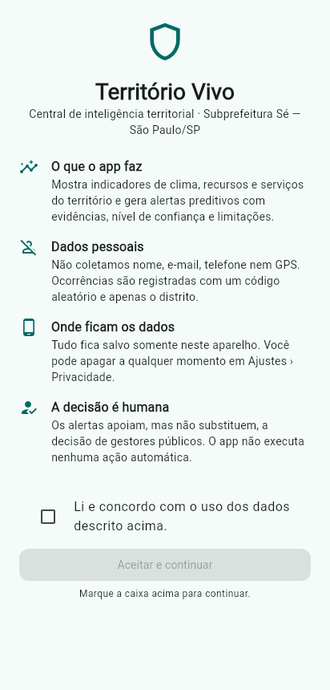<br>**Consentimento**: termo LGPD obrigatório no 1º uso; o botão só libera após marcar a caixa | 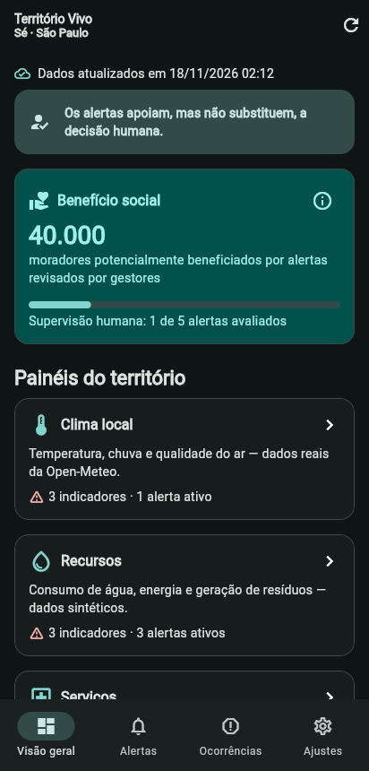<br>**Visão geral**: aviso de decisão humana, indicador de benefício social e atalhos para os painéis | 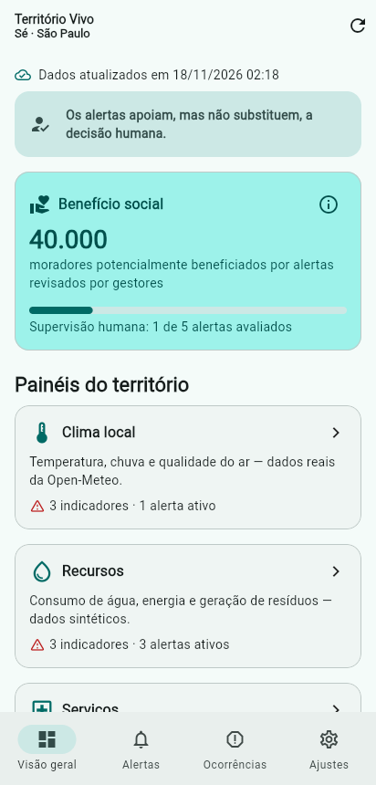<br>**Tema claro**: a mesma tela no tema claro |

**Dashboards territoriais**

| | | |
|:---:|:---:|:---:|
| 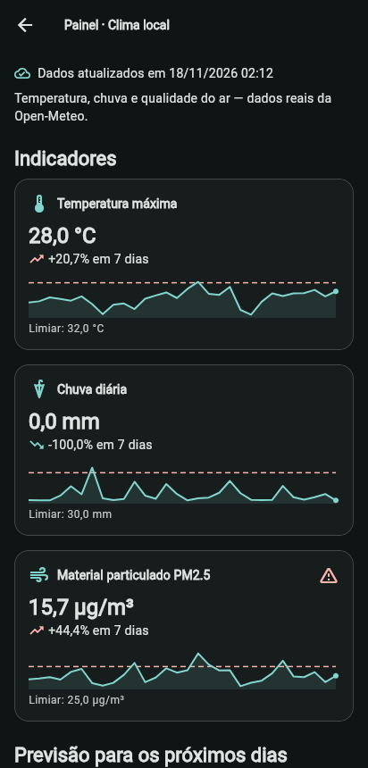<br>**Painel Clima**: temperatura, chuva e PM2.5 reais (Open-Meteo), com variação em 7 dias e limiar | 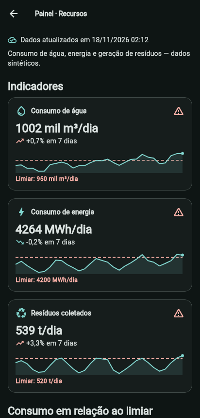<br>**Painel Recursos**: água, energia e resíduos (sintéticos) com indicadores acima do limiar | 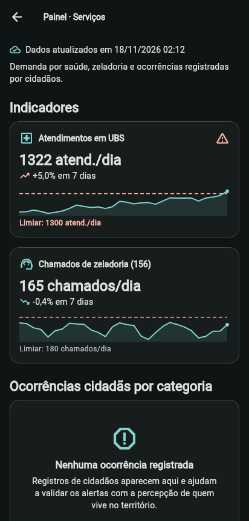<br>**Painel Serviços**: UBS, zeladoria (156) e ocorrências cidadãs, com estado de lista vazia |

**Indicador e alertas**

| | | |
|:---:|:---:|:---:|
| 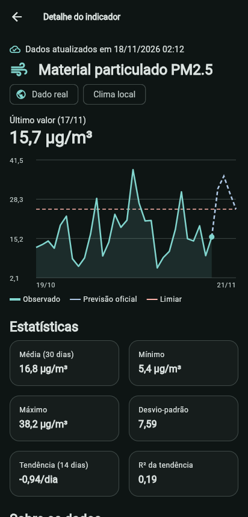<br>**Detalhe do indicador**: histórico de 30 dias, previsão oficial tracejada, limiar e estatísticas | 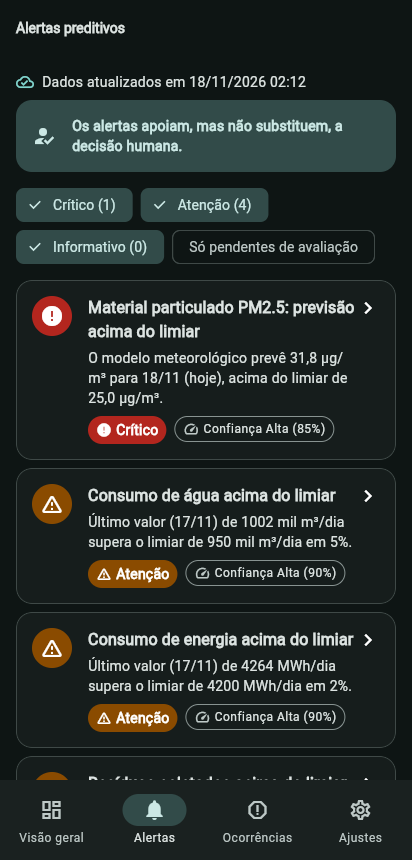<br>**Alertas**: lista com filtros por severidade e selos de confiança | 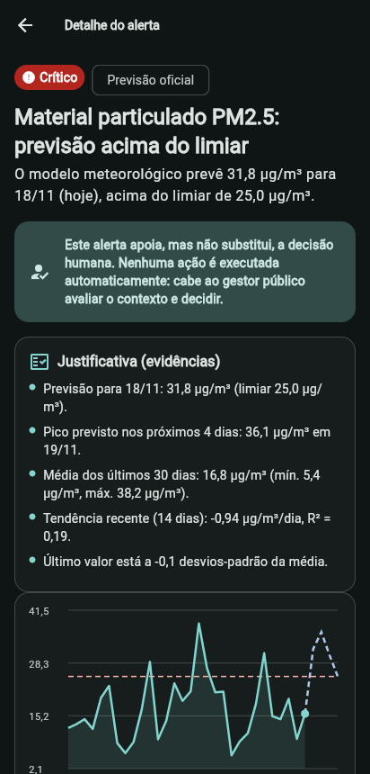<br>**Detalhe do alerta**: severidade, aviso de decisão humana e justificativa com evidências |

**Transparência e decisão humana**

| | | |
|:---:|:---:|:---:|
| 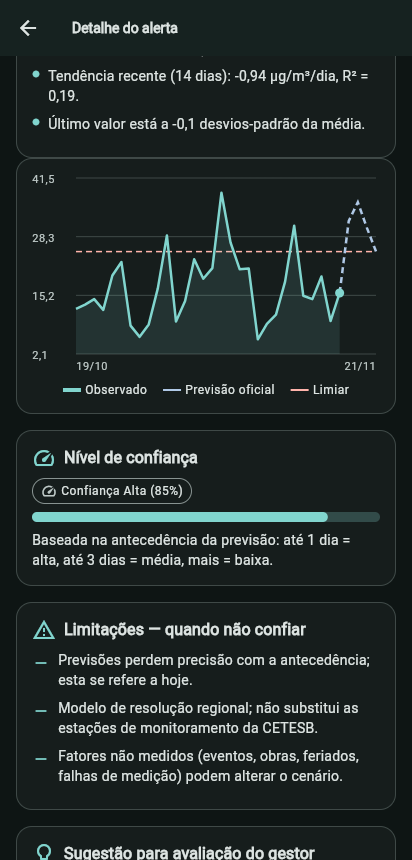<br>**Confiança e limitações**: nível de confiança com o motivo da nota e quando não confiar | 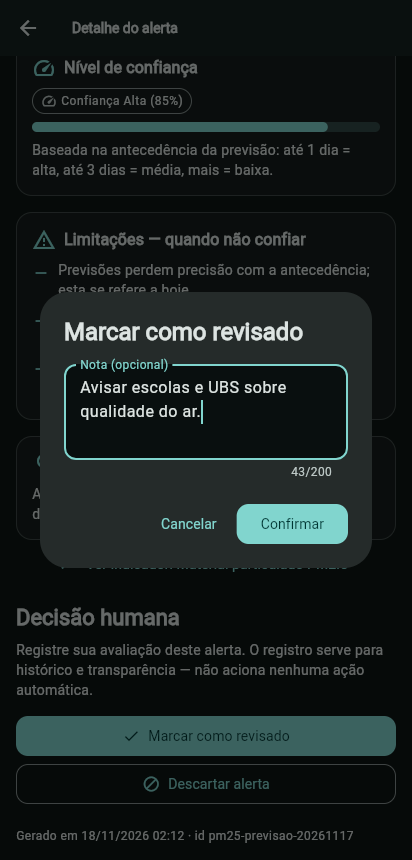<br>**Decisão humana**: o gestor marca como revisado ou descarta, com nota opcional | 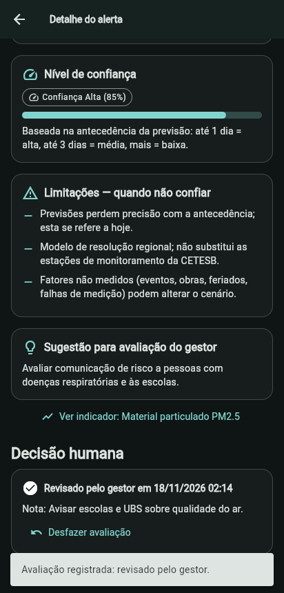<br>**Decisão registrada**: avaliação salva localmente, sem nenhuma ação automática |

**Ocorrências cidadãs (formulário)**

| | | |
|:---:|:---:|:---:|
| 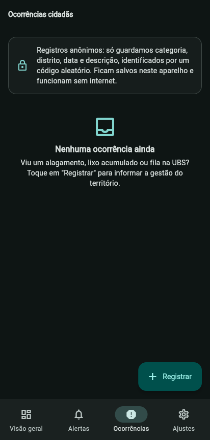<br>**Ocorrências (vazia)**: estado de lista vazia e aviso de anonimato | 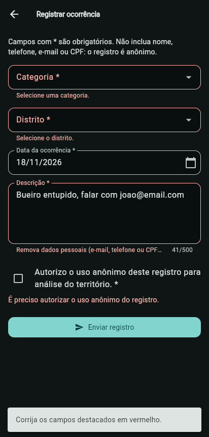<br>**Formulário com erros**: validação de campos obrigatórios e bloqueio de e-mail na descrição | 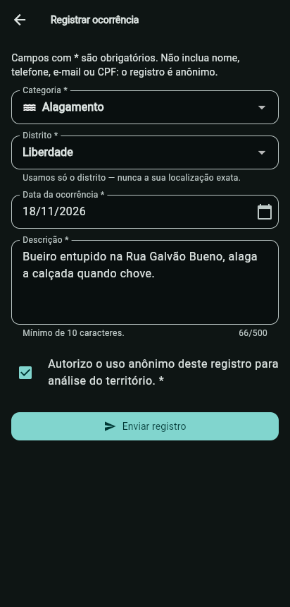<br>**Formulário válido**: categoria, distrito, data, descrição e autorização anônima |

**Registro salvo, limiares e ajustes**

| | | |
|:---:|:---:|:---:|
| 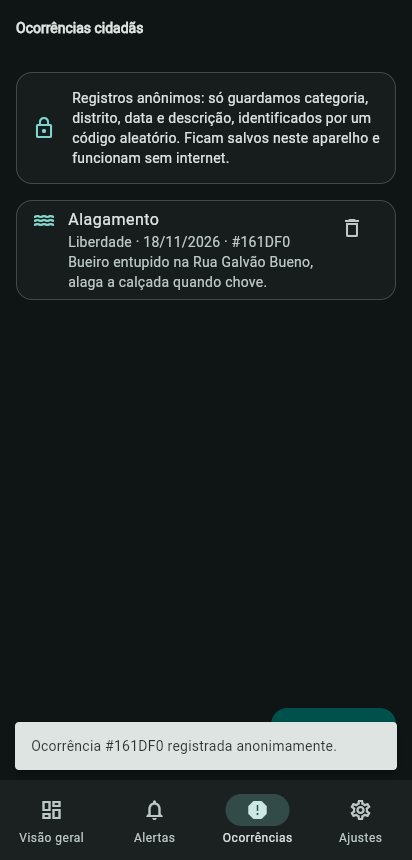<br>**Ocorrência registrada**: salva no aparelho com código aleatório, sem dados pessoais | 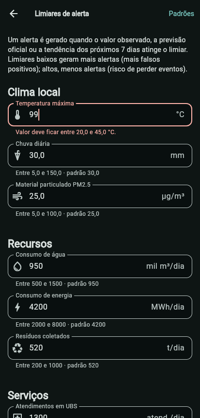<br>**Limiares de alerta**: formulário do gestor com validação de faixa por indicador | 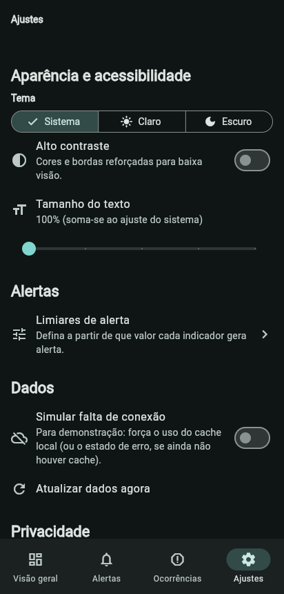<br>**Ajustes**: tema, alto contraste, tamanho do texto, modo offline e privacidade |

**Offline e acessibilidade**

| | | |
|:---:|:---:|:---:|
| 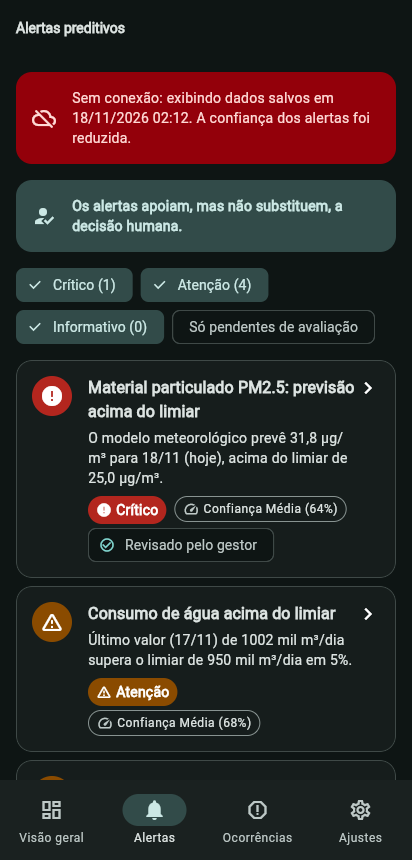<br>**Modo offline**: dados em cache com aviso; a confiança dos alertas cai (85% → 64%) | 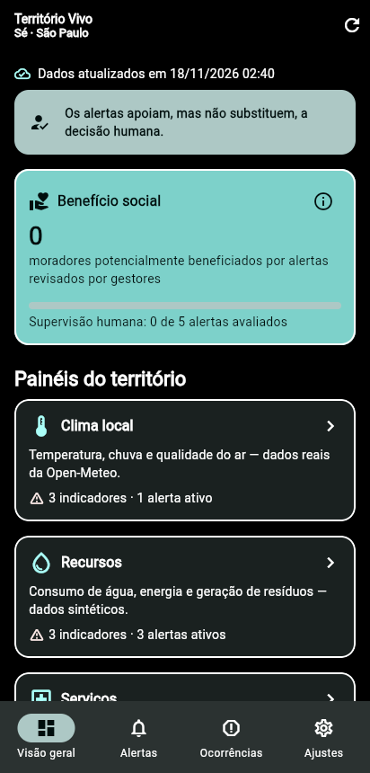<br>**Alto contraste**: tema escuro com cores e bordas reforçadas | 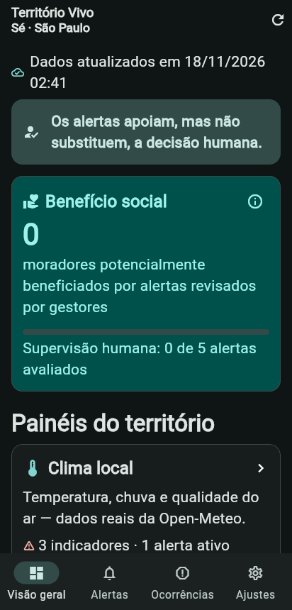<br>**Fonte ampliada (150%)**: layouts que quebram linha sem cortar texto |

## 5. Funcionalidades

- [x] 10 telas (consentimento, visão geral, painel, indicador, alertas, detalhe do alerta, ocorrências, formulário, ajustes e limiares), com rotas nomeadas e passagem de parâmetros: Consentimento → Visão geral → Painel → Indicador → Alerta (e Alerta → Indicador)
- [x] 3 dashboards distintos (**Clima**, **Recursos** e **Serviços**) com cards de KPI, mini-gráficos, variação semanal, tendência e uma seção própria de cada tema
- [x] Alertas gerados por regras e previsões, cada um com **justificativa (evidências)**, **nível de confiança** (com o motivo da nota), **limitações** e sugestão de ação
- [x] Aviso visível de que os alertas **apoiam, mas não substituem, a decisão humana**. Nenhuma ação é automática: o gestor apenas registra "revisado" ou "descartado"
- [x] Estado global (`provider`) compartilhado entre Visão geral, Painéis, Indicador, Alertas, Ocorrências e Ajustes
- [x] Estados de carregamento, erro (com "Tentar novamente") e lista vazia tratados em todas as listas
- [x] Consumo de API real (Open-Meteo, clima e qualidade do ar) e de API simulada (serviços municipais)
- [x] Persistência local de ocorrências, limiares, preferências, avaliações de alertas, consentimento e cache dos dados
- [x] Funciona sem conexão: usa o último cache, mostra um aviso e reduz a confiança dos alertas
- [x] Dois formulários com validação: registro de ocorrência (cidadão) e limiares de alerta (gestor)
- [x] Indicador de benefício social na Visão geral
- [x] Tema próprio com componentes reutilizáveis, **modo escuro** e **alto contraste**
- [x] Animações com propósito: contador do benefício social, gráficos que se desenham (observado → projeção), barras que se preenchem, pulso em alertas críticos e transição entre telas. Respeitam a opção de reduzir movimento do sistema
- [x] Acessibilidade: rótulos para leitor de tela, ajuste de fonte até 200% e alvos de toque ≥ 48 dp
- [x] 29 testes automatizados: unidade (motor de alertas, validações), widget e um teste de fumaça que percorre todas as telas em celular, tablet, fonte 200% e tema escuro com alto contraste
- [x] Layout responsivo (1 coluna no celular, 2 ou mais em tablet/web)

## 6. Dados e alertas

### Fontes
| Painel | Indicador | Fonte | Tipo |
|---|---|---|---|
| Clima | Temperatura máxima, chuva diária | [Open-Meteo Forecast API](https://open-meteo.com/en/docs) (30 dias passados + 7 de previsão) | **Público, real** |
| Clima | PM2.5 (média diária) | [Open-Meteo Air Quality API](https://open-meteo.com/en/docs/air-quality-api), modelo CAMS | **Público, real** |
| Recursos | Água, energia, resíduos | `SyntheticApi`, que simula as APIs das concessionárias | **Sintético** |
| Serviços | Atendimentos em UBS, chamados de zeladoria (156) | `SyntheticApi` | **Sintético** |
| Serviços | Ocorrências cidadãs | Registradas no próprio app | **Autorizado (consentimento)** |

As séries sintéticas combinam tendência, sazonalidade semanal e ruído, com semente fixa por dia. Assim os valores são reproduzíveis e cobrem cenários de alerta e de normalidade. Elas aparecem marcadas como "Dado sintético" no app.

### Como os alertas são gerados (`lib/domain/alert_engine.dart`)
Cada indicador gera **no máximo um alerta**, seguindo esta prioridade:

1. **Limiar ultrapassado.** O último valor observado já está acima do limiar configurado. A severidade é *Crítico* se estiver ≥ 20% acima e *Atenção* nos demais casos. Confiança base: 0,90, por ser um valor medido.
2. **Previsão oficial.** O modelo meteorológico prevê um valor acima do limiar nos próximos dias (vale só para clima). A confiança depende da antecedência: até 1 dia = 0,85, até 3 dias = 0,65, mais que isso = 0,45.
3. **Tendência estatística.** Uma regressão linear por mínimos quadrados sobre os últimos 14 dias projeta o cruzamento do limiar em até 7 dias. Só gera alerta se a inclinação for de alta e **R² ≥ 0,3**. Confiança = 0,35 + 0,5 × R². É *Atenção* se o cruzamento for em até 3 dias e *Informativo* se for depois disso.

**Penalidades de confiança:** dados vindos do cache (offline) multiplicam a confiança por 0,75, e histórico com menos de 14 dias multiplica por 0,8. Faixas finais: **Alta** ≥ 0,75, **Média** ≥ 0,5, **Baixa** abaixo disso.

**Evidências exibidas:** valor observado ou previsto, limiar, média, mínimo e máximo de 30 dias, inclinação da tendência, R², valor projetado e z-score do último valor.

### Métricas usadas
Média, desvio-padrão, mínimo e máximo, variação percentual em 7 dias, inclinação da regressão (unidades/dia), R² e z-score.

### Limitações e possíveis vieses
- **Resolução espacial:** o modelo meteorológico usa uma grade de cerca de 11 km e não captura ilhas de calor de ruas específicas. O PM2.5 vem do CAMS, um modelo regional que não substitui as estações da CETESB.
- **Chuva convectiva** (comum no verão) é localizada e difícil de prever.
- **Dados sintéticos** não representam medições reais. Em produção, dependeriam de telemetria das concessionárias e dos sistemas municipais.
- **Viés de notificação:** chamados ao 156 e ocorrências cidadãs dependem de a população registrar. Regiões que reclamam menos parecem ter menos problemas.
- **Atendimentos nas UBS** medem a demanda atendida, não a demanda reprimida.
- **A projeção linear** supõe que o padrão recente continua.

### Quando as previsões **não** são confiáveis
- Com histórico curto (menos de 14 dias) ou R² baixo, o app reduz a confiança e não gera alerta de tendência.
- Com dados do cache (sem conexão), o app reduz a confiança e mostra um aviso.
- Em previsões com mais de 3 dias de antecedência, a confiança é baixa.
- Mudanças bruscas (feriados, grandes eventos, obras, falhas de medição) invalidam a tendência. Esse aviso aparece em todo alerta.

## 7. Privacidade e inclusão

**Privacidade (LGPD):**
- **Consentimento explícito** no primeiro uso, sem o qual o app não pode ser usado. O termo pode ser revisto em *Ajustes › Privacidade*.
- **Anonimização por construção:** a ocorrência **não tem** campos de nome, contato ou GPS. Guarda só a categoria, o **distrito**, a data, a descrição e um **código aleatório** (`Random.secure`).
- **Bloqueio de dados pessoais** na descrição: o validador rejeita e-mail, telefone e CPF.
- Os dados ficam **apenas no aparelho**, e *Ajustes › Apagar meus dados* remove ocorrências, avaliações e consentimento.
- Nenhuma chave de API no código: a Open-Meteo não exige autenticação.

**Acessibilidade e inclusão:**
- Todo card, gráfico e alerta tem um rótulo `Semantics` descritivo. Os gráficos descrevem em texto o histórico, a projeção e o limiar.
- Títulos marcados como *header* para navegação por leitor de tela, e regiões de aviso (offline, carregamento) como *live region*.
- O **tamanho do texto** é ajustável no app (até 200%) e se soma ao ajuste do sistema. Os layouts usam `Wrap`, `Expanded` e listas roláveis para não cortar texto.
- **Modo escuro** e **alto contraste** (manuais ou seguindo o sistema). As cores de severidade usam texto branco sobre fundo com contraste ≥ 4,5:1, e o estado nunca é comunicado só por cor: sempre há ícone e texto junto.
- Alvos de toque de no mínimo 48 dp e linguagem simples nas explicações.

## 8. Tecnologias e decisões técnicas

| Escolha | Justificativa |
|---|---|
| **Flutter 3.44 / Dart 3.12** | Um código para Android e Web, com Material 3 |
| **`provider`** | Estado global simples e conhecido, baseado em `ChangeNotifier`. Quatro estados focados (`TerritoryState`, `SettingsState`, `OccurrencesState` e `DecisionsState`); o estado local (aba ativa, filtros, campos de formulário) fica em `StatefulWidget` |
| **`http`** | Cliente HTTP oficial do Dart, suficiente para dois endpoints REST |
| **`shared_preferences`** | Persistência local em JSON. O volume é pequeno, então não vale trazer um banco (Hive ou SQLite) |
| **`flutter_localizations`** | Calendário e textos do Material em pt-BR |
| **Navigator com rotas nomeadas** (nativo) | `onGenerateRoute` com `arguments` tipados atende ao fluxo sem dependência extra. `onGenerateInitialRoutes` impede voltar da tela de consentimento para a home |
| **Gráficos com `CustomPainter`** (nativo) | Linha do histórico, previsão tracejada e limiar, sem biblioteca de gráficos: controle total do visual e da acessibilidade, e menos risco de quebra de API |
| **Open-Meteo** | Dados reais e abertos de clima e qualidade do ar, sem chave de API |

**Arquitetura (camadas por responsabilidade):**
```
lib/
├── main.dart                 # injeta dependências e providers
├── app.dart                  # MaterialApp, temas e tabela de rotas
├── core/                     # tema, tokens, rotas, formatação, widgets reutilizáveis
│   └── widgets/              # KpiCard, TrendChart, AlertTile, HumanDecisionBanner, EmptyState...
├── data/                     # modelos, território, APIs (real e sintética), cache e repositório
├── domain/                   # motor de alertas, impacto social e validadores (Dart puro, testável)
├── state/                    # estados globais (ChangeNotifier)
└── features/                 # telas por funcionalidade
    ├── onboarding/  home/  dashboard/  indicator/
    └── alerts/  occurrences/  settings/
test/                         # unidade, widget e teste de fumaça de todas as telas
```

## 9. Como executar

**Pré-requisitos:** Flutter 3.44+ **ou** apenas Docker. O projeto tem uma imagem própria (`docker/Dockerfile`, baseada em `ghcr.io/cirruslabs/flutter:3.44.0`, com Android SDK 36) e o script `scripts/flutter.sh`, que constrói a imagem na primeira execução e roda qualquer comando `flutter` dentro dela.

```bash
# 1. Clonar
git clone https://github.com/LucasWerppFranco/Global-Solution-Cross-Platform.git
cd Global-Solution-Cross-Platform

# 2a. Com Flutter instalado
flutter pub get
flutter test                 # testes de unidade e de widget
flutter run                  # emulador/dispositivo Android
flutter run -d chrome        # ou no navegador

# 2b. Com Docker (sem SDK local): a imagem territorio-vivo-flutter é construída na 1ª execução
./scripts/flutter.sh pub get
./scripts/flutter.sh test
./scripts/flutter.sh build apk --release      # gera build/app/outputs/flutter-apk/app-release.apk
DOCKER_ARGS="-p 8080:8080" ./scripts/flutter.sh run -d web-server --web-hostname 0.0.0.0 --web-port 8080
```

**Variáveis de ambiente:** nenhuma é necessária, porque a Open-Meteo não exige chave. Se uma fonte autenticada for adicionada no futuro, a chave deve ser passada com `--dart-define` e nunca versionada (`.env` já está no `.gitignore`).

**Dica para a demonstração:** em *Ajustes › Limiares de alerta*, baixe um limiar (por exemplo, a temperatura máxima para 25 °C) e salve para ver um alerta ser gerado na hora. Em *Ajustes › Simular falta de conexão*, veja o modo offline.

## 10. Vídeo

<p align="center">
  <a href="https://youtu.be/25I8QykbYW4" title="Assistir à demonstração no YouTube">
    
  </a>
</p>

▶️ **Demonstração (até 3 min):** [territorio vivo demo](https://youtu.be/25I8QykbYW4). Clique na imagem acima para assistir no YouTube.

## 11. Licença

Projeto acadêmico, FIAP, Global Solution 2026.2, disciplina Cross-Platform Application Development. Dados de clima: Open-Meteo, sob licença CC BY 4.0.
